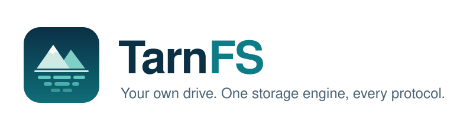

  <picture>
    <source media="(prefers-color-scheme: dark)" srcset="assets/banner-dark.svg">
    
  </picture>

  
  
  

**TarnFS is an open-source, self-hosted drive.** It is a Rust file system with its own content-addressed storage engine. You reach it over REST, S3, WebDAV and MCP, from a web app, a CLI and a native Mac client. One binary runs on a Raspberry Pi, and the same code scales out to Postgres and S3 without a rewrite.

## Why TarnFS

- **Its own storage engine.** Files are split into content-defined chunks, hashed with BLAKE3, deduplicated and compressed with zstd. Corruption is detected on read, and a scrub checks everything at rest.
- **Every protocol, one write path.** REST, S3, WebDAV, MCP and the Mac app all go through the same core and the same permission checks.
- **Small to start, room to grow.** Start with SQLite on a local disk. Move to Postgres, an S3 backend or separate workers when you need to.
- **Nothing gets lost.** Every file has versions and a trash.
- **AI agents with guardrails.** Agents work on your files through scoped, auditable permissions, with any provider.
- **Heavy parts stay optional.** ML search, OCR, video and full-text indexing are separate workers, off by default.

## Status

TarnFS is in active development and has not had a release yet.

| Milestone | What it brings | |
| --- | --- | :---: |
| M1 Storage engine | chunking, dedup, compression, local disk and S3 backends | ✅ |
| M2 Usable drive | web app, CLI, REST API, versions, trash, Docker image | ✅ |
| M3 Protocols | S3 gateway and WebDAV | 🚧 |
| M4 Teams | OIDC, sharing, roles, public links | |
| M5 Search | by name, format, metadata and colour | |
| M6 AI | MCP server and scoped agent sessions | |

## Repositories

| Repo | What |
| --- | --- |
| [server](https://github.com/TarnFS/server) | Rust workspace: server, CLI and workers, Docker image |
| [web](https://github.com/TarnFS/web) | SvelteKit web app, embedded in the server binary |
| [mac](https://github.com/TarnFS/mac) | native Mac app |
| [tarnfs](https://github.com/TarnFS/tarnfs) | spec, roadmap, shared rules and bootstrap |

## License

TarnFS is free software under the [GNU AGPL-3.0](https://www.gnu.org/licenses/agpl-3.0.html).
